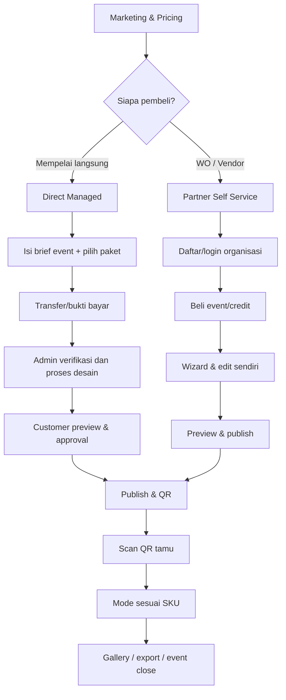

# USER FLOWS & STATE MACHINES — v2

## 1. Channel routing

## 2. DIRECT_MANAGED — buyer/pengantin
1. Pilih `Pesan untuk Pengantin`, lihat paket 99/150/299/499 dan batasan dengan copy manusiawi.
2. Pilih Rp99k → form **tidak menampilkan frame**, layout, strip, custom design. Isi pasangan/event, waktu, kontak, opsional cover/headline, catatan. Pilih paket lain → boleh memberi referensi warna atau inspirasi kepada operator, **tetapi buyer tidak edit sendiri**.
3. Kirim order → `awaiting_payment`, instruksi transfer/unggah bukti → admin verify → `paid`.
4. Order masuk `Fulfillment Queue`; admin/Komukuna assigned mengisi/set event, memilih template bila cocok, menyiapkan QR dan preview.
5. Customer menerima preview, `setujui` atau `minta revisi` (quota plan); admin menyelesaikan; jika Mini, revisi 0 (boleh koreksi kesalahan input/typo oleh admin).
6. Admin publish setelah pembayaran terverifikasi dan event valid; customer mendapat QR, jadwal, link galeri dan status.
7. Saat event, tamu mengirim foto/voice/video/notes; client dapat mengakses private gallery dan ekspor via izin.
8. Setelah event, admin close, retensi berjalan; customer bisa download selama owner export window.

**Skenario error:** proof rejected → upload ulang; waktu event sudah dekat → urgency badge untuk operator; preview tidak diapprove → hanya admin override beralasan; request revisi melebihi jatah → tawarkan add-on/upgrade, bukan auto-charge.

## 3. PARTNER_SELF_SERVICE — vendor/WO
1. Pilih `Saya WO/Vendor`, buat/login akun dan organisasi, email verification bila auth memerlukan; pilih per-event SKU/credit.
2. Jika Mini, wizard melompati tema/frame editor (no-frame). Untuk Classic+, partner dapat pilih/edit frame sendiri; semua entitlement limits dicek server.
3. Event detail → enabled modes, caption, guest identity, quota, media privacy, film reveal, voice/video limits, file/QR → preview as guest.
4. Publish jika order/credit paid & settings valid; create QR; opsional invite operator dan client gallery access.
5. Partner memiliki live event console, gallery moderation, livewall (entitled), export, add-on dan event analytics scoped tenant.
6. Partner dapat clone event, tetapi media, guest identity, payment dan tenant access tidak ikut ter-copy.

## 4. GUEST — Mini Rp99k (mobile first)
QR → welcome privacy consent → **menu `Kamera 15 Foto`, `Pesan Suara`, `Video Ucapan`, `Tulis Pesan`, `Galeri`** → pilih kamera → identify guest (name/session or invite code) → permission camera by click → capture → filter film lightweight → review/save → upload progress/retry → counter 14/15 → gallery if allowed.
- No frame picker anywhere and no photo strip anywhere.
- Voice: record≤30s → listen → submit once → owner-private default.
- Video: record≤15s or gallery upload allowed → inspect MIME/duration/bytes → preview → submit, progress/resume → confirm server committed.
- Notes: display name optional, text validated/sanitized, success status with visibility.
- Any mode deep-link blocked if SKU excludes it.

## 5. GUEST — Classic+ photo strip
Welcome → choose Photo Strip → frame picker limited by entitlements/published frame set → camera request → timer/capture each slot → retake selected → final preview/filter → save/export and upload → success/gallery. Server counts 1 photo output per saved composite. Active capture uses immutable frame revision.

## 6. OPERATOR/Admin flow
Work queue paid orders → assign staff → intake assets → create event version → QA preview mobile → send to buyer → revisions → publish → monitor upload moderation → close/export. `platform_admin` can manage catalog; `designer` can't change price/payment or access other orders unless assigned. Authorized `partner_operator` can moderate assigned event but not billing.

## 7. State machines
- `orders.status`: `draft -> awaiting_payment -> payment_review -> paid | payment_rejected | expired`; `paid -> refunded` auditable.
- `fulfillment.status`: `not_started -> assets_requested -> in_preparation -> preview_ready -> revision_requested -> preview_ready -> client_approved -> delivered` (Mini can skip unnecessary steps; compensation path on cancel).
- `events.status`: `draft -> scheduled -> live -> closed -> archived` plus reversible `paused`. Order and event statuses separate.
- `media.status`: `intent -> uploading -> processing -> pending_review -> approved/published`, with `failed/rejected/hidden/deleted`; successful finalize idempotent.
- `capture`: `idle -> camera_permission -> capture -> review -> render -> upload -> saved`; quit/retry/no-permission states explicit.
- `video`: `idle -> permission -> recording -> stopped -> preview -> uploading -> processing -> saved` or cancel/fail.

## 8. URL design
Marketing `/`, `/harga`, `/fitur`, `/contoh`, `/untuk-vendor`.
Direct `/pesan`, `/pesan/[orderId]`, `/akun/pesanan`, `/akun/pesanan/[id]/preview`, `/akun/event/[id]/galeri`.
Partner `/partner/login`, `/partner/onboarding`, `/partner/dashboard`, `/partner/events/new`, `/partner/events/[id]/edit`, `/partner/events/[id]/media`, `/partner/events/[id]/qr`, `/partner/events/[id]/analitik`.
Admin `/admin/orders`, `/admin/fulfillment`, `/admin/events`, `/admin/partners`, `/admin/packages`, `/admin/moderation`, `/admin/system`.
Guest `/e/[slug]`, `/e/[slug]/disposable`, `/e/[slug]/photo`, `/e/[slug]/voice`, `/e/[slug]/video`, `/e/[slug]/notes`, `/e/[slug]/gallery`; display `/live/[eventId]?token=...` (token scope/revocable; prefer not in log).

## 9. Failure/recovery UX
Camera deny → upload alternative where allowed, correct permission guide. Mic deny → explanatory state. Safari MIME unsupported → choose supported container or upload prerecorded video; never fake success. Failed upload → keep local file until user explicitly discards, retry idempotently. Offline → download local result or queue ephemeral data with clear status. Event paused/closed → meaningful explanation. Storage or per-guest quota exhausted → server 409 with relevant remaining and owner contact. Film reveal pending → no signed original delivery. Video worker failure → support/retry, no permanent spinner. QR invalid → 404 branded not unrelated event.
