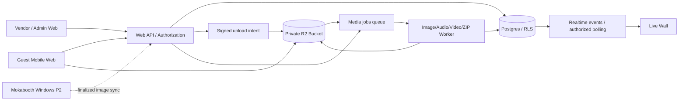

# TECH ARCHITECTURE — v2 REQUIRED AMENDMENTS

## Normative decisions
- `ADR-008` **Two-channel checkout with single backend**: `sales_channel=direct_managed|partner_self_service` plus scoped org/role permissions, not separate unsafe duplicate APIs.
- `ADR-009` **All core web features delivered in one continuous run**, including video for Mini and WO/vendor self editor. Legacy statements `video P1` or `partner P2` below are superseded.
- `ADR-010` **Mini no-frame code splitting**: guest Mini uses a small disposable capture module, NEVER loading React Konva or editor packages. Frame/strip routes require `plan.features.photo_strip=true` backend check. Direct buyer portal never imports frame studio. Admin designers and eligible partners lazy-load it.
- `ADR-011` **Video processing mandatory** in core: MediaRecorder MIME/codec negotiation; server worker using FFmpeg (installed in deployment environment and version-pinned by worker image), max bitrate+duration+bytes; async processing and retry. For heavy uploads use R2-compatible S3 multipart or separate resumable provider; do not assume R2 implements TUS. Never embed FFmpeg.wasm in Mini guest initial bundle.
- `ADR-012` Install Playwright + browser binaries in target repo at W0; tests multi role and browser, final comprehensive after features are present. Read 15_PLAYWRIGHT_TEST_STRATEGY.
- `ADR-013` Budget initial compressed JS guest welcome target <=180KB, LCP/INP/CLS and media cost reporting; read 16_PERFORMANCE_AND_MEDIA_BUDGET.
- `ADR-014` Edit responsibility is authorization: client purchase token cannot PATCH events, even if request crafted manually; partner owner may edit within org and entitlements; platform fulfillment designer delegated to assigned orders. Cross-tenant references denied in storage/exports.

## Media pipeline v2
Choose R2 Standard private bucket for photo/audio/video original or video uploaded; workers generate thumbs/transcoded playback. `event_usage` enforces file counts and bytes with transactionally reserved quota. Mini 2GiB cap and 15 exposures/guest/30 guests/450 total; 10 videos×15s and 50 voice×30s. Normalize/remove EXIF metadata. Keep `media_assets` source/kind (disposable/strip/voice/video/note/physical).

## Package graph
`packages/authz` includes `canEditEvent(user, event, channel, role, entitlement)`, `canEditFrame`, `canManageDirectOrder`, `canModerate`, `canReadAsset`. `packages/plan-entitlements` isomorphic types but **server authoritative**. `apps/web` route groups marketing/direct/partner/admin/guest; `apps/worker` processing videos/ZIP/book, no huge payload inside Next.js request handler.

## Deployment/runtime strategy
Web can boot locally using test DB/storage/dev worker fixtures, but actual paid launch requires properly configured secure DB, R2, domain HTTPS, payment verification, worker runtime, backups, observability. Do not claim serverless edge runtime can execute FFmpeg. No secret keys in client.

---

## TECHNICAL REFERENCE (v1 details; use only where consistent with v2)

# TECHNICAL ARCHITECTURE — KOMUKUNA VIRTUAL
**Technical reference carried forward from v1.0 | proposed stack; validate actual Mokabooth/BOOKING stack during M0**

## 1. Architecture decision record
**ADR-001 Web-first:** guest and vendor browser app are standalone; do not change or build Mokabooth Windows in early phases. **ADR-002 Modular monorepo:** share typed packages where viable, no direct copy of entire old repos. **ADR-003 Database tenancy:** Postgres tenant isolation/RLS+server authorization from day one. **ADR-004 Object storage:** R2 Standard by default for cost predictability, private objects behind authenticated signing/proxy; DO NOT assume R2 supports Supabase TUS endpoints. **ADR-005 Jobs:** worker for previews/transcode/exports and retention; no long media processing in Next.js server request. **ADR-006 Theme:** BOOKING tokens for platform chrome; event themes scoped independently. **ADR-007 Payments:** manual verification MVP, BYO or platform gateway later after due diligence.

## 2. Proposed stack
| Layer | Candidate | Notes |
|---|---|---|
| Workspace | `pnpm` monorepo, Turborepo optional | adopt existing workspace tool if audited |
| Web | Next.js App Router, TypeScript strict | separate marketing/guest/dashboard routes initially in one app, split when scaling |
| UI | Tailwind + accessible component primitives (shadcn/ui/Radix) | re-map styles from BOOKING |
| State/data | TanStack Query for remote state, React state for ephemeral capture | avoid backend state in localStorage as authority |
| Camera | MediaDevices `getUserMedia`, video/canvas capture | HTTPS, user gesture, permission handling |
| Voice & video | MediaRecorder + runtime MIME negotiation | test Safari/Chrome formats |
| Frame editor | reuse Mokabooth React if proven compatible, otherwise `react-konva` | canvas output deterministic and versioned |
| Effects | Canvas 2D + WebGL as needed | performance benchmarks before GPU filters |
| Validation | Zod and server-side validation | strong schema type inference |
| DB & auth | Supabase Postgres/Auth | RLS, sql migrations, no service role in client |
| Storage | Cloudflare R2 Standard | private S3-compatible, signed operations, operations cost measured |
| Jobs | BullMQ + Redis **if available** or managed queue/worker matching deploy | durable retries/dead-letter monitoring |
| Email | reliable transactional provider | not core blocker manual pilot |
| Observability | structured logs/error tracking + traces | privacy redaction |
| Testing | Vitest, Playwright, actual Android/iOS manual acceptance | targeted during build; full gate near pilot |

Dependency versions are not pinned in prose: agent records currently installed versions and chooses stable compatible releases after `pnpm-lock.yaml`/package audit, pins exact in lockfile and ADR.

## 3. High-level data flow


**Warning:** object storage does not generally emit application events to your queue automatically without explicit bucket notifications/integration. Initial flow: client uploads to presigned URL, then calls `finalize`, server verifies object metadata and enqueues durable processing job. Storage notifications are optional supplementary reconciliation only.

## 4. Monorepo target layout
```text
komukuna-virtual/
  apps/
    web/                  # marketing, guest, client & dashboard route groups
    worker/               # thumbnails, transcode, exports, cleanup
  packages/
    ui/                   # BOOKING-derived verified primitives/tokens
    design-tokens/        # semantic design contract and theme assets
    event-domain/         # shared types, policies, quotas, event lifecycle
    frame-schema/         # Zod schema, normalized geometry and versions
    frame-renderer/       # browser renderer, future desktop interoperability
    frame-editor/         # design editor UI, audited reuse
    camera-web/           # getUserMedia capture state machine
    media/                # uploader, media types and processing schema
    authz/                # authorization policies and role definitions
    config/               # env parsing and feature flags
  infra/
    migrations/
    storage/
    deployment/
  docs/
    product/
    audit/
    adr/
    runbooks/
```

## 5. Camera implementation
- `getUserMedia({video:{facingMode:'user'},audio:false})` after button press; support fallback facingMode and enumerateDevices only post-permission where possible.
- iOS: `playsInline`, muted local video preview, no unsolicited autoplay with sound; sensor rotations and mirrored preview vs captured output corrected.
- Capture still via canvas video frame, target adaptive resolution for output/layout; avoid upscaling a low-res capture and calling it HD.
- Countdown driven by animation frame or correctly canceled timers; eliminate duplicate snapshots under rapid taps.
- Stop all MediaStream tracks when leaving camera mode or backgrounding; handle visibility and device change.
- Image render output via deterministic schema; compare golden sample pixel tolerance across preview/server worker if worker handles rendering.
- Keep originals as optional only; don't store unnecessary duplicated full-res inputs where per-event storage tight.

## 6. Photo/frame data contract
```ts
export type FrameV1 = {
  schemaVersion: 1;
  id: string;
  version: number;           // immutable once published
  width: number; height: number; // output pixel dimensions
  output: { format: 'jpeg' | 'png'; quality: number };
  background?: { kind: 'solid' | 'image'; value: string };
  slots: Array<{
    id: string; x: number; y: number; width: number; height: number; // normalized 0..1
    rotate: number; aspectRatio?: number; fit: 'cover' | 'contain'; z: number;
  }>;
  overlays: Array<{ id: string; kind: 'image' | 'text'; assetRef?: string;
    text?: string; x: number; y: number; width: number; height: number; z: number }>;
  safeZones?: Array<{ x:number; y:number; width:number; height:number }>;
};
```
Validate bounds/rotation/asset refs, reject arbitrary remote URLs and scriptable SVG. Build a shared test fixture set for landscape 6x4, portrait 4x6, 2-cut, 3-cut, 4-cut and 6-cut. For backwards compatibility: write adapters from Mokabooth schema only after inspecting actual field definitions. Do not claim schema is already implemented.

## 7. Upload pattern for R2
1. Backend authenticates guest event token; evaluates plan/storage/media-size/rate limits.
2. Backend creates a DB `media_upload_intent` with idempotency key, TTL and **reserved quota**.
3. Backend signs **PUT to one exact random object key** in tenant/event-scoped prefix; only permitted content type & bytes (enforced on backend/finalize, not blindly trusted headers).
4. Browser PUTs binary directly to R2 via signed URL; progress; retry same intent if possible.
5. Browser calls finalize API. Backend HEAD-verifies presence, bytes and MIME through content inspection where necessary; transaction marks finalized only once.
6. Worker sanitizes EXIF, creates thumbnail, optional transcoded derivatives; media enters pending moderation/approved policy.
7. Reconciliation job cleans expired intents/orphan objects and returns quota reservation.

For >single PUT reliability (video), choose between **S3 multipart uploads to R2** using correct compatible uploader + server signing, **or** intentionally use Supabase Storage's native TUS endpoint for videos. Do **not** wire `tus-js-client` to an R2 endpoint as if TUS exists there. Document and validate one chosen solution before building P1 video.

## 8. Realtime and live wall
DB event state changes → scoped realtime event dispatch (or authenticated polling). Operator view receives approved-only gallery item ID/thumbnail signed scoped access; updates coalesced; reconnect with last seen cursor and full refresh fallback. Public live-wall URL requires display token, revoke support, and 15-min media URLs renewed by authorized session; avoid embedding service role credentials in public screen.

## 9. Processing worker design
`media.verify`, `image.thumbnail`, `image.strip-render` (if server render chosen), `audio.normalize` (P1), `video.transcode` (P1), `gallery.export.zip`, `book.render` (P1), `retention.cleanup`, `quota.reconcile`, `payment.audit`, `analytics.rollup`. Queue tasks use deterministic job IDs, exponential backoff, max retries and DLQ/review queue. Media conversion runs sandboxed with file and time limits. ZIP stream or chunk storage; never hold multi-GB full event export in request memory.

## 10. Nonfunctional targets and performance
- **Supported baseline:** current Chrome Android and Safari iOS (test devices/OS documented); camera fallback available.
- Target guest JS first view lean; heavy Konva, filters, media editor lazy loaded on mode entry; avoid hydration-heavy landing.
- Initial pilot load test: >=100 concurrent active sessions with realistic media size/rate; characterize DB connections, signing throughput, queue lag.
- P95 API routes for event bootstrap/read ideally <700ms under representative test env; critical upload signing <1s target; define actual SLO after pilot measurement.
- Fail-closed on auth & quota, fail-soft on slideshow/no real-time (polling fallback), fail-safe on media processing retries.
- Env separation dev/staging/prod, CI required lint/types/build, targeted smoke; staged rollout.

## 11. Security implementation references
Postgres RLS tenant memberships + separate backend authorization for guest tokens. Use signed URLs with short expiry and random object keys; encrypt in transit, storage vendor encryption, secrets manager, strict CORS, CSP especially media SVG, content type sniffing, rate limit by token/IP hashed, CSRF protections for cookie sessions, authenticated webhook signatures for future gateway, admin MFA if enabled. See `09_SECURITY_PRIVACY_OPERATIONS.md`.

## 12. ADRs agent must resolve in M0
- Exact BOOKING UI stack and design token source.
- Exact Mokabooth capture/layout schema and legal reuse.
- Whether to deploy web as one Next.js app route groups or separate deploys.
- Cloudflare R2 Standard choice, S3 multipart support for P1; image and audio format matrix.
- Queue provider after hosting choice; no indefinite in-memory jobs in serverless.
- Schema migration tool aligned to existing infra; don't mix multiple migration authorities.
